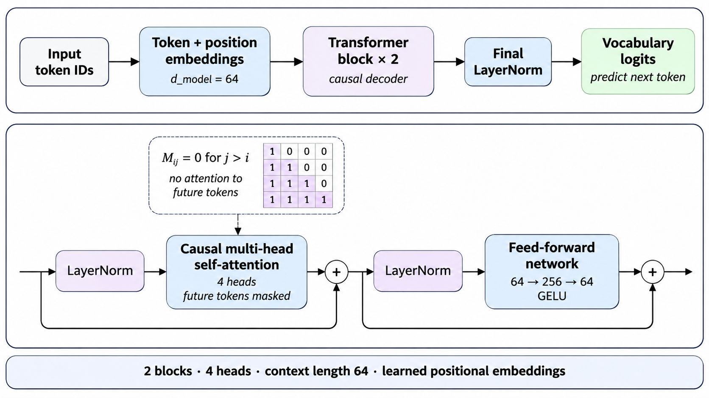
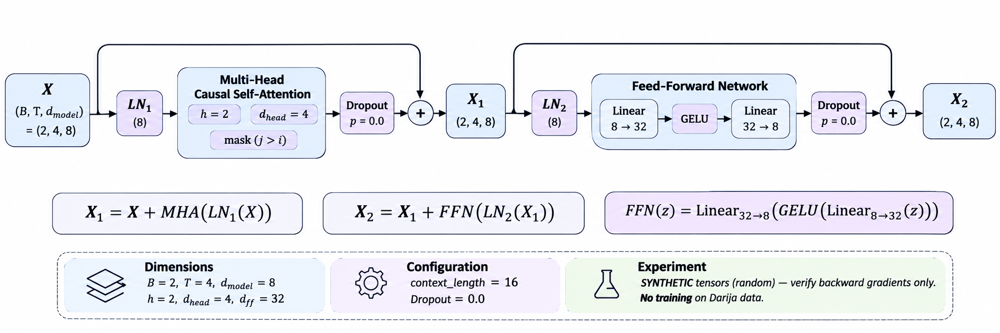
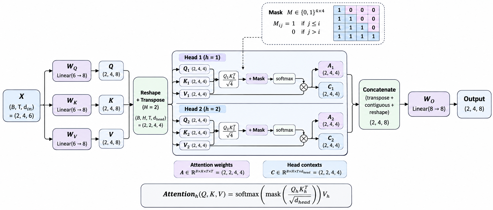

---
language:
  - ar
  - ary
pipeline_tag: text-generation
library_name: pytorch
tags:
  - darija
  - moroccan-arabic
  - proof-of-concept
---

# Darija LLM Lab — Proof of Concept

## Model summary

This is an experimental decoder-only language model for Moroccan Darija, trained from random initialization. It is a small educational proof of concept, not a production-ready language model. Its generated samples are still repetitive and are not reliably fluent.

## Architecture

- Decoder-only GPT with 2 Transformer blocks
- Embedding width: 64
- Attention heads: 4
- Context length: 64 tokens
- ByteLevel BPE tokenizer with a 2,000-token vocabulary
- Published checkpoint: step 500

### Overall model

The model adds token and position embeddings, processes the sequence through causal Transformer blocks, then predicts a distribution over the next token.

### Transformer decoder block

Each block combines multi-head causal attention and a feed-forward network with residual connections and normalization.

### Multi-head causal attention

The attention heads process separate learned feature subspaces in parallel; their outputs are combined into one representation.

## Intended use

- Educational experiments with next-token language modeling for Moroccan Darija.
- Inspecting a small custom PyTorch GPT and its training behavior.

Do not rely on this model for factual answers, translation, moderation, or consequential decisions.

## Training data

Training used only the `darija` column from [AtlasIA's `darija_english` dataset](https://huggingface.co/datasets/atlasia/darija_english), pinned to revision `c6468fe948155c935c7a8ce59db7df895ad1296a`. The checkpoint's split contains 900 training documents and 100 validation documents; no dataset files are distributed here. The tokenizer was trained on the training split only.

The source dataset declares **CC BY-NC 4.0**. This card does not grant separate rights to the derived checkpoint. Review the source terms and applicable rights before reusing or redistributing data or weights.

## Training and evaluation

The model was trained from random weights with next-token cross-entropy and AdamW. The 500-step checkpoint includes 200 initial steps, 100 resumed steps, and 200 additional steps with cosine learning-rate decay. Checkpoint selection used validation data.

| Metric | Validation result |
| --- | ---: |
| Cross-entropy loss | 6.6795 |
| Perplexity | 795.94 |

These measurements describe this small held-out split only. They are not a benchmark of general Darija ability. The generated samples remain repetitive and are not considered fluent.

## Limitations

- The corpus and model are small, so outputs may be incoherent, repetitive, or incorrect.
- Darija spelling, dialect, and code-switching vary; representation may be uneven.
- The split removes exact duplicates, but near-duplicate stories may remain.
- This checkpoint has no separate held-out test score in its published evaluation summary.
- The source data is non-commercial; review the dataset terms before reuse.

## Files and code

The repository includes `model.safetensors`, `tokenizer.json`, `config.json`, and `evaluation_summary.json`. The checkpoint uses this project's custom PyTorch classes and is **not directly loadable with `transformers.AutoModel`**.

The training notebooks and current project workflow are in the [Darija LLM Lab GitHub repository](https://github.com/BADR-JOULAlI/darija-llm-lab). The published checkpoint records an earlier 900/100 data split; later notebook runs can use updated data and produce different results.
