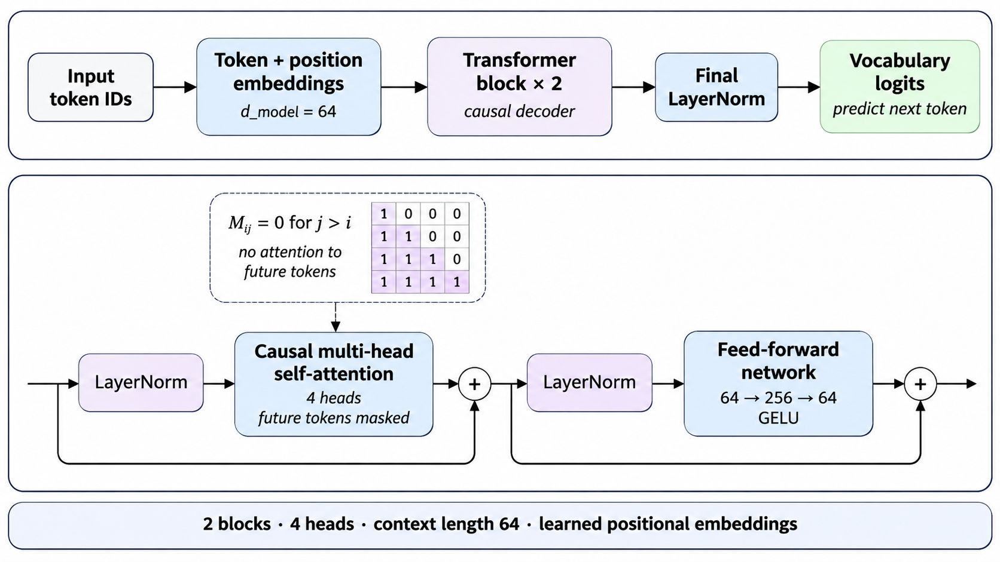
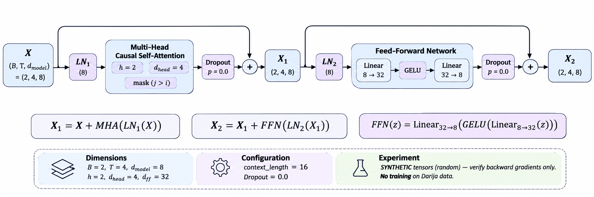
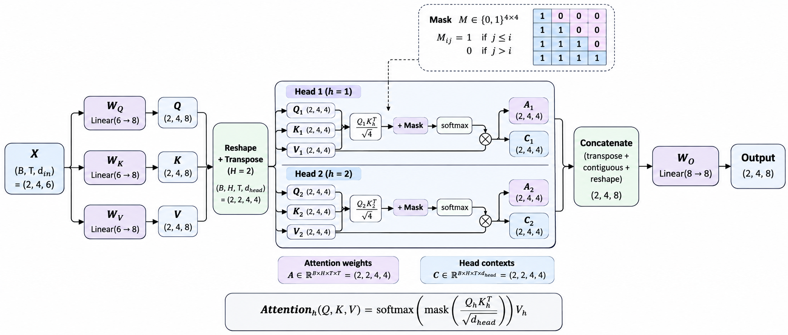

# Darija LLM Lab

An educational Python and PyTorch project for building a Darija language model from scratch: preparing AtlasIA data, training a BPE tokenizer, implementing attention and Transformer blocks, pretraining from random weights, and evaluating text generation.

The notebooks build the project step by step, from Darija text preparation and tokenization to a Transformer language model. All project code and examples are written for Moroccan Darija.

Data comes from datasets published by [AtlasIA](https://huggingface.co/atlasia). The vocabulary and BPE merges are learned from our training corpus. The project currently uses neither a pretrained tokenizer nor pretrained model weights.

See the [model card](MODEL_CARD.md) for the model's architecture, data, intended use, and limitations.

## Current status

The project is organized as **standalone Jupyter notebooks** with explanations and code cells. Notebooks 01–03 prepare the data, tokenizer, and sliding windows. Notebooks 04–06 introduce causal attention, implement it in PyTorch, and extend it to multiple attention heads. Notebook 07 assembles a Transformer block. Notebook 08 puts the components together into a GPT, trains it on the Darija corpus, and evaluates it on held-out data. Notebook 09 reviews the saved metrics and generated samples. Notebook 10 resumes training from a checkpoint and compares validation results. Notebook 11 tests a lower learning rate with cosine decay.

The notebooks are designed to run from top to bottom, with outputs saved so results are visible on GitHub. Start with notebook 01 to prepare document-level train, validation, and test splits. Notebook 02 trains the tokenizer using only training text. Notebook 08 trains a small GPT; notebooks 10–11 select checkpoints using validation only; run notebook 09 last to review the final test score and generated samples. The test split is not used to train the tokenizer, choose checkpoints, or compare experiments. The saved model, tokenizer, and dataset files remain local and are excluded from Git.

## Notebooks

| Notebook | What it builds |
| --- | --- |
| [01 - Prepare Darija data](notebooks/01_prepare_darija_data.ipynb) | Read the `darija` column, normalize and deduplicate, then create train/validation/test splits by document |
| [02 - Build our tokenizer](notebooks/02_build_darija_tokenizer.ipynb) | Word-tokenizer example, BPE concepts, ByteLevel BPE training, checks, measurements, and saving |
| [03 - Sliding windows](notebooks/03_sliding_windows.ipynb) | Shifted inputs and targets, context length, stride, document boundaries, and batches |
| [04 - Causal attention concepts](notebooks/04_causal_attention_concepts.ipynb) | Queries, keys, values, attention weights, causal masking, and context vectors with small Python calculations |
| [05 - Causal attention in PyTorch](notebooks/05_causal_attention_pytorch.ipynb) | Trainable Q/K/V projections, causal masking, batches, and a reusable module |
| [06 - Multi-head attention](notebooks/06_multi_head_attention.ipynb) | Split Q/K/V into heads, compute masked attention in parallel, combine head outputs, and verify tensor shapes |
| [07 - Transformer block](notebooks/07_transformer_block.ipynb) | Pre-normalization, residual connections, multi-head causal attention, and a GELU feed-forward network |
| [08 - Train and evaluate a Darija GPT](notebooks/08_train_and_evaluate_darija_gpt.ipynb) | Token and position embeddings, class-based GPT model, document-safe batches, training loop, validation loss, perplexity, checkpointing, and text generation |
| [09 - Review model evaluation](notebooks/09_review_model_evaluation.ipynb) | Review the final held-out test score, inspect generated samples, and calculate simple n-gram diversity indicators |
| [10 - Resume training and compare](notebooks/10_resume_training_and_compare.ipynb) | Restore model and optimizer states, continue training, compare held-out loss, and retain the better checkpoint |
| [11 - Scheduled training experiment](notebooks/11_scheduled_training_experiment.ipynb) | Continue from the best checkpoint with cosine learning-rate decay and compare validation loss and a fixed generation |

## Visual guides

The diagrams below are embedded in the relevant notebooks, beside a short explanation of the concept. Some use toy tensors to make the flow easy to follow; they illustrate the idea rather than report live training measurements.

| Notebook | Visual topic |
| --- | --- |
| [02 - Tokenizer](notebooks/02_build_darija_tokenizer.ipynb) | ByteLevel BPE learns frequent merges from training text |
| [03 - Sliding windows](notebooks/03_sliding_windows.ipynb) | Inputs and next-token targets shift across windows |
| [04 - Causal attention](notebooks/04_causal_attention_concepts.ipynb) | The mask blocks access to future tokens |
| [05 - Attention in PyTorch](notebooks/05_causal_attention_pytorch.ipynb) | Tensor projections, masking, softmax, and context vectors |
| [06 - Multi-head attention](notebooks/06_multi_head_attention.ipynb) | Independent heads are combined into one representation |
| [07 - Transformer block](notebooks/07_transformer_block.ipynb) | Attention, residual connections, normalization, and the feed-forward network |
| [08 - Darija GPT](notebooks/08_train_and_evaluate_darija_gpt.ipynb) | The model architecture and next-token training loop |
| [10 - Checkpoints](notebooks/10_resume_training_and_compare.ipynb) | Monitoring, checkpointing, and resume flow |

## Model architecture

These three diagrams summarize the small decoder-only GPT and its main building blocks. They are explanatory figures; the model configuration used by the notebooks is **2 Transformer blocks, 4 attention heads, embedding width 64, context length 64, and a 2,000-token vocabulary**.

### Darija GPT overview



The model adds token and position embeddings, processes the sequence through causal Transformer blocks, then predicts a distribution over the next token.

### Transformer decoder block



Each block combines multi-head causal attention and a feed-forward network with residual connections and normalization.

### Multi-head causal attention



The attention heads process separate learned feature subspaces in parallel; their outputs are combined to form one representation.

## Install

Python 3.10 or newer is required. From the repository directory:

```powershell
python -m venv .venv
.\.venv\Scripts\Activate.ps1
python -m pip install -r requirements.txt
```

## Open the project

```powershell
python -m jupyterlab notebooks
```

Open notebook 01, select the Python environment installed above, and use **Run All**. Run notebooks 01–08, then 10, 11, and 09 in that order; each notebook starts a fresh kernel, so run the preceding notebooks first to create its required files. Notebook 01 needs an internet connection the first time it downloads the pinned CSV. Notebooks 08, 10, and 11 train the model and can take longer on a CPU. The project can also be opened in VS Code with Jupyter support.

## Local data and outputs

Notebook 01 uses only the `darija` column from [atlasia/darija_english](https://huggingface.co/datasets/atlasia/darija_english).

Notebook 01 downloads the pinned CSV into this directory when it is missing. You can also place a CSV here and set `DOWNLOAD_DATA = False` in the notebook. Existing files are reused.

Files produced when you run the notebooks:

- `data/processed/train.jsonl`, `validation.jsonl`, and `test.jsonl`: document splits;
- `data/processed/corpus_manifest.json`: data provenance, hashes, and preprocessing settings;
- `artifacts/tokenizer/tokenizer_darija.json`: tokenizer trained in notebook 02;
- `artifacts/tokenizer/training_manifest.json` and `evaluation.json`: training settings, provenance, and validation measurements.
- `artifacts/evaluation/final_test_evaluation.json` and `generation_samples_final.jsonl`: one final test score and deterministic samples from the checkpoint selected using validation data.

The `data/` and `artifacts/` directories are excluded from Git. Exact normalized duplicates are removed before splitting. Near-duplicate stories can still cross splits, so the final score remains a small proof-of-concept result.

## Reload the tokenizer

```python
from tokenizers import Tokenizer

tokenizer = Tokenizer.from_file("artifacts/tokenizer/tokenizer_darija.json")
tokenizer.encode_special_tokens = True

text = "salam, labas?"
encoded = tokenizer.encode(text, add_special_tokens=False)
print(encoded.ids)
print(tokenizer.decode(encoded.ids, skip_special_tokens=False))
```

With Tokenizers 0.22.1, restore the `encode_special_tokens=True` flag after reloading. It keeps literal strings such as `[EOS]` as ordinary text. The real document-ending marker is added explicitly by its ID.

## Notebook checks

Assertions are placed next to the concepts they check: splits have no exact duplicates in common, Unicode text round-trips after normalization, literal special-token strings are handled correctly, saved tokenizer IDs remain stable after reloading, targets are shifted by one token, and windows preserve document boundaries.

These checks do not measure the quality of a future LLM. The tokenizer is fit only on training documents. The final model score is reported on the reserved test documents after checkpoint selection is complete.

## Data and attribution

The `atlasia/darija_english` dataset lists a **CC BY-NC 4.0** license on its [Hugging Face page](https://huggingface.co/datasets/atlasia/darija_english). The data's terms and attribution requirements apply independently of this code. Corpus files are not redistributed in this repository.

[Atlaset](https://huggingface.co/datasets/atlasia/Atlaset) is another possible resource. Access requires accepting its Hugging Face terms; the current notebooks use the public `darija_english` dataset.

The notebook explanations and code were prepared for this project.

## Planned progression

1. Prepare and inspect a Darija corpus.
2. Build the tokenizer and sliding windows.
3. Implement causal attention in PyTorch, add multi-head attention, and assemble the Transformer block.
4. Assemble a small GPT and train its parameters from scratch.
5. Select training settings with validation data, then evaluate once on the reserved test split.
6. Improve generation quality with more reviewed data and a fixed qualitative evaluation set.
